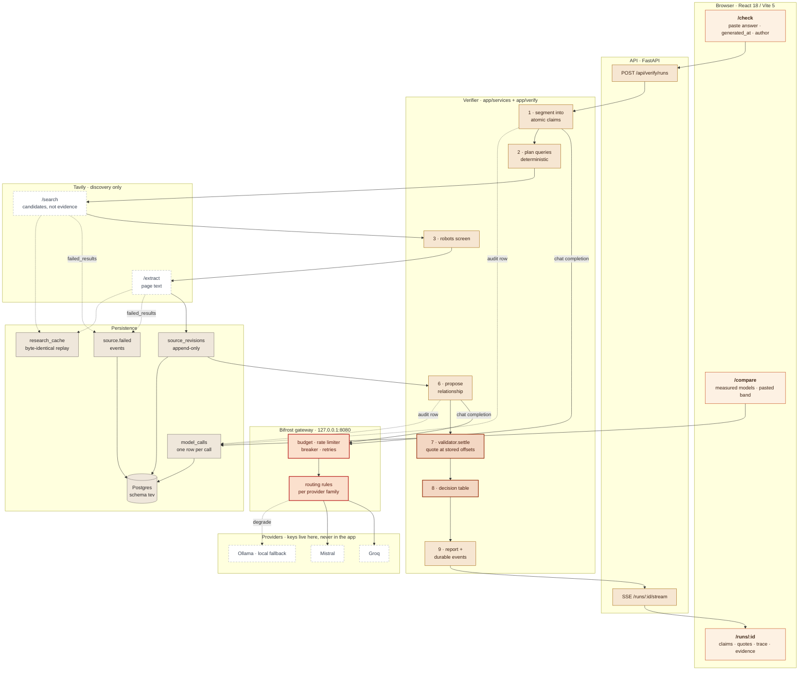
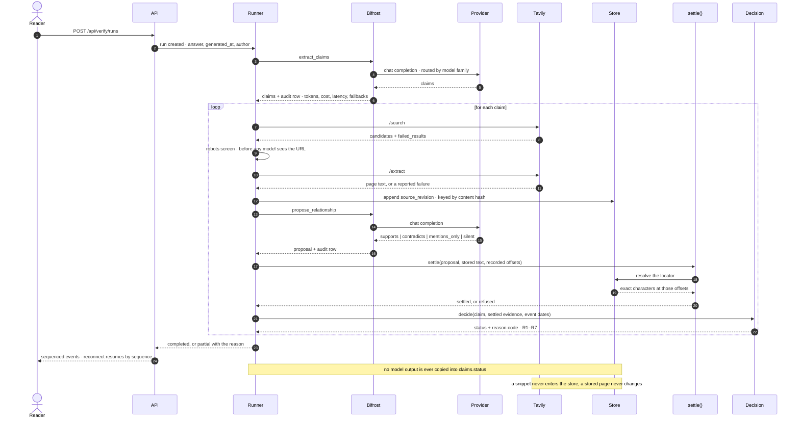
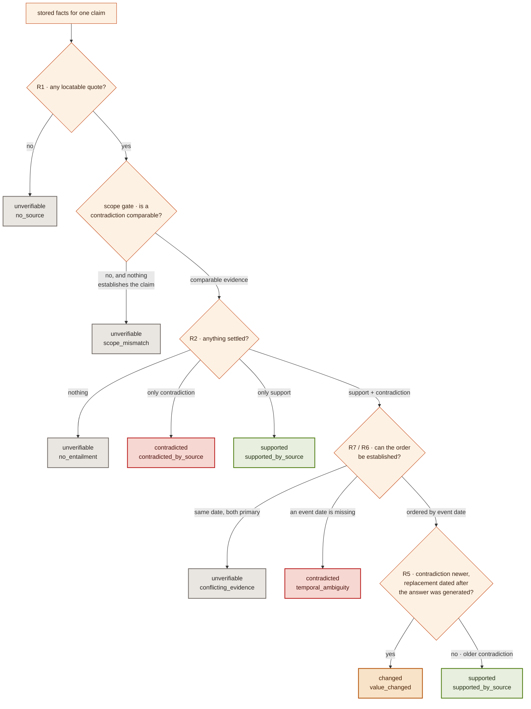

# Afterfact

**Claim-level verification for AI answers, with the event date kept separate from
the publication date.**

An AI answer is not true or false. It is a set of claims that may have been
supported when it was written, changed afterwards, been contradicted, or never
been verifiable. This product decides which, per claim, and shows the proof.

You paste an answer, the moment it was generated and who wrote it. You get back:

- **atomic claims** with subject, predicate, value, qualifiers and volatility;
- **live research** through Tavily search and extract, with every fetched page
  stored as an append-only revision;
- **exact quotes** that resolve at recorded offsets against the stored text;
- **four separate timestamps** — when the answer was generated, when the source
  was published, when the fact itself changed, and when we retrieved it;
- a **deterministic verdict** per claim — `supported`, `changed`, `contradicted`
  or `unverifiable` — with a reason code and the evidence that produced it;
- a **reproducible evidence pack** (Markdown and JSON) plus a screen where every
  number shown is a stored row, not a computed decoration.

A model never decides a status. It proposes one of four relationships per claim;
the verifier settles that proposal against stored text and the rule table
assigns the verdict. That boundary is the product.

It is not a search engine and not a chatbot. It does not ask "is this true now?"
It asks what the answer was worth **when it was written**, and it will say
`unverifiable` rather than dress a guess as a verdict.

---

## Two external services do the heavy lifting, under contract

Afterfact is not a prompt wrapped in a UI. Its two dependencies are the two
places where a verifier can silently lie, so both are integrated narrowly, both
are audited per call, and both are replaceable only by changing code:

| Dependency | What it is allowed to do | What it is never allowed to do |
|---|---|---|
| **Bifrost** (`:8080`, OpenAI-compatible) | route a prompt to a provider, retry, fall back, meter cost | decide anything, keep provider keys in this backend, or answer without leaving an audit row |
| **Tavily** (search + extract) | find candidate URLs, return page text | supply evidence, become source text, or hide a URL that failed |

Everything below is about those two boundaries, because that is where the
integrity of the product actually lives.

### One run, and where each service sits in it

1. **Segment the answer into atomic claims** — a model call, through Bifrost.
2. **Plan queries per claim** — deterministic templates, deliberately no model.
3. **Discover candidates** — Tavily `/search`; its snippets are not evidence.
4. **Screen by robots policy** — before any model is asked about the URL.
5. **Fetch page text** — Tavily `/extract`, stored append-only as `source_revisions`.
6. **Propose a relationship per claim** — a model call, through Bifrost.
7. **Settle the quote at stored offsets** — code, not a model (`validator.settle`).
8. **Read the event date** — code; `missing` when the page does not say.
9. **Assign the verdict** — the rule table, with `RULE_VERSION` stamped on it.

Neither service is trusted with a decision. The model may say "this passage
refutes the claim"; that proposal is worth nothing until a locatable quote
resolves in text the store actually holds. Tavily may return a page; it becomes
evidence only once it has been extracted, stored and cited by offset. Every step
above that can fail leaves a recorded row and, where it matters, a
`source.failed` or failed `model_calls` entry — so a partial run is a reported
outcome rather than a quiet green tick.

---

## Bifrost: the only road to a model

`backend/app/bifrost/client.py` is the only road from the verifier to a model.
Not by convention — by test. `backend/tests/verify/test_no_direct_providers.py`
parses every module under `app/` and fails if `groq`, `openai`, `anthropic`,
`mistralai`, `ollama`, `tavily`, `litellm`, `langchain` or any of a dozen other
SDKs appears as an import in `app/verify`, `app/research` or `app/api`. It also
asserts the boundary is not vacuous: the gateway client must contain the one
chat-completions URL, and the verifier must actually call it. A comment saying
"all model calls go through the gateway" is worth nothing; a test that reads the
import graph is worth something.

For verification the backend holds **one** credential for models: a virtual key
that only works against a gateway bound to `127.0.0.1`. Provider keys live in
the gateway's environment, and `bifrost/config.json` sets the gateway the way a
serious deployment would — `enforce_auth_on_inference: true`,
`allow_direct_keys: false`, `disable_content_logging: true` — so prompt text is
not written into the gateway's content log by default.

### What the gateway owns, and what this repo owns

| Concern | Lives in | Why there |
|---|---|---|
| provider credentials | gateway environment | the backend cannot leak what it never holds |
| routing | `bifrost/config.json`, CEL rules per provider family | a single rule once rewrote a Mistral call to Groq and nothing said so; now each family has its own rule and `test_bifrost_config.py` checks every target is a configured provider |
| fallback | gateway | `groq/*` degrades to `ollama/llama3.2:1b`; `mistral/*` deliberately does **not**, because quietly answering a judge prompt with a small local model changes the verifier's brain without changing the model name in the record |
| retries | `app/bifrost/retry_policy.py` | exponential backoff with full jitter, plus a circuit breaker on repeated 429s, so app retries × gateway retries cannot multiply |
| pacing | `app/bifrost/rate_limiter.py`, `scheduler.py` | thread-safe TPM/RPM sliding windows reconciled against provider headers (`x-ratelimit-remaining-*`, `retry-after`) |
| budget | `client.py`, `app/governance/resource_budget.py` | `BIFROST_BUDGET_USD` (default `$5`) is checked against summed spend before a call, not after |
| audit | `tev.model_calls` | one row per call: request id, **provider actually used**, model, input/output tokens, cost, latency, fallback attempts, status |
| replay | `model_calls` keyed by `(prompt_hash, model, stage)` | a replayed answer is labelled `snapshot` with its original timestamp; it is never presented as live |

### Why the audit row matters more than the UI

`model_calls` is what makes the rest of the system checkable. It is why
`/api/compare/models` can print measured calls, tokens, average cost, latency,
error rate and verdict mix per model — and why pasted answers appear as a
separate band marked `no model recorded` instead of being attributed to a model
that never saw them. It is also why the budget check is honest: it sums rows,
not intentions.

Two consequences worth stating plainly:

- **A model failure never produces a verdict.** `BifrostError` carries a kind —
  `transient`, `fatal`, `cache_miss`, `budget` — and the run records it, emits
  its event and ends `partial` if it must. There is no path from "the gateway
  refused" to "the claim is unverifiable".
- **`CACHE_MODE` is a guarantee, not an optimisation.** `read-write` calls the
  network on a miss and stores the response. `read-only` treats a miss as an
  error, which is what makes demo and evaluation runs reproducible. `off` never
  reads and never writes.

### The one documented exception

The playground has two sources, and the UI says which one is in use. "This
deployment" is a call made with the gateway's own virtual key: same route as a
verification, no credential in the browser. "Your endpoint" is a model this
deployment has never heard of, reached with a key you paste — it bypasses the
gateway, and the page tells you so rather than implying otherwise.

That gateway call is the deliberate exception to the audit rule: it writes **no**
`model_calls` row, no cache entry and no budget line. The playground has no run
to attach a row to, and inventing one would put a side call into the accounting a
run is judged by. An accounting table that contains things that are not part of
the run is worse than a table that is one row short and knows why.

---

## Tavily: discovery and extraction, never evidence

`backend/app/research/tavily.py` speaks to Tavily over HTTP directly. The Tavily
SDK is in the forbidden-import list for the same reason as the model SDKs: it
hides `failed_results`, and a verifier that cannot see its failed fetches will
report success while dropping half its sources.

Two API calls with deliberately different powers:

- **`/search`** returns candidates. Its `content` field is a snippet written by
  the search engine. It is used to decide what to fetch and **never** becomes
  evidence.
- **`/extract`** returns page text. That text — not the snippet — is stored as a
  `source_revisions` row, append-only, keyed by content hash. A quote must cite
  a row that exists; offsets index the full stored text, and model windows are
  `(chunk_start, chunk_end)` ranges rebased before insert.

What the integration does with the parts everyone else skips:

- **Queries are deterministic on purpose.** `research/planner.py` builds search
  queries from the claim's own fields with templates, not with a model. A
  model-planned query looks impressive and makes the evaluation unreproducible:
  the same claim searched twice yields different evidence, so a verdict changes
  for reasons unrelated to the sources. A weaker query costs a missed source,
  which is reported as `unverifiable` — not a wrong verdict.
- **HTTP 200 does not mean every URL worked.** Both endpoints return a
  `failed_results` array alongside the successes. Every entry is returned to the
  caller, which emits `source.failed`. A failed extraction is a reported event,
  not a silent skip, and partial runs are a first-class outcome.
- **Robots before tokens.** A candidate whose robots policy forbids fetching is
  screened out *before* the judge sees it, so no model call is spent on a page
  that may not be read; the per-claim URL cap then backfills with crawlable
  alternatives (`backend/tests/test_robots_gate.py`).
- **Independence is counted, not assumed.** `research/source_independence.py`
  fingerprints the stored revision text behind each piece of evidence and groups
  identical content, so the UI can say "three sources, two independent origins"
  instead of "five articles that copied the same press release are five
  confirmations". It is reported next to the evidence and never changes a verdict.
- **Replays are byte-identical.** `research_cache` is keyed by
  `hash(tool, request-without-credentials)`, so a replayed response is labelled
  `snapshot` and carries its original timestamp — never dressed as a live fetch.

---

## When a dependency is down, the product says so

This is the part that separates an instrument from a demo:

| Situation | Behaviour |
|---|---|
| Gateway unreachable | `GET /api/verify/gateway` reports `health.ok: false`; the gateway-routed playground source says it cannot reach the gateway; a verification run records the failed call, ends `partial`, and produces **no** verdict for the affected claims |
| No provider key in the gateway | client reports `configured: false`; the report names the stage that could not run instead of inventing one |
| Budget exhausted | calls stop at the budget line with kind `budget`; the already-recorded rows stay |
| No Tavily key | research cannot run, sources are recorded as failed, and nothing is promoted on a snippet |
| `CACHE_MODE=read-only` and no cached entry | the miss is an error, not a quiet network call |
| A fetch fails | `source.failed` with the URL and reason; the run is `partial`, never quietly greener |

The current local store is the proof this path is exercised, not illustrated. It
holds 155 recorded calls (`model_calls` in Postgres, `calls` in the JSON store),
and the three models that actually answered are visible because `model` and
`resolved_model` are separate columns:

- `groq/openai/gpt-oss-20b` served `openai/gpt-oss-20b`;
- `mistral/mistral-small-latest` served `mistral-small-latest`;
- **10 rows were requested as `groq/openai/gpt-oss-20b` and answered by
  `llama3.2:1b` through the local Ollama fallback** — the degrade path in
  `bifrost/config.json` fired, and the record says which model really answered.

The same table keeps 34 error rows next to 121 ok rows, $0.016967 across the 57
priced calls, and 47 claims carrying their reason codes. Nothing in it is
reconstructed for a screenshot: the demo film reads these rows.

---

## The rule that matters

A claim becomes `changed` only when a replacement value is **locatable**,
**settled** through `validator.settle`, and carries an **event date after the
answer was generated**. A newer article is not a change. A publication date is
not an event date. A failed search is not a contradiction. A failed support is
not a contradiction either — a contradiction needs its own synthetic cell with
the replacement value and its own locatable quote.

Four clocks, never merged:

| Field | Means | Lives on |
|---|---|---|
| `answer_generated_at` | when the answer was produced | `answers.generated_at` |
| `publication_date` | when the source said it was published | `source_revisions.published_date` |
| `event_date` | when the underlying fact changed | `evidence_spans.event_date` |
| `retrieved_at` | when we fetched it | `source_revisions.retrieved_at` |

Unknown `event_date` is `missing`. It never falls back to `publication_date`.

---

## What is enforced, not promised

| Claim | Enforced by |
|---|---|
| Only `validator.settle` may grant `verified`, and only with a support verdict plus a locator that resolves | `backend/tests/test_promotion_chokepoint.py` (parses every module for a literal `"verified"` write) |
| No provider SDK outside `app/bifrost` | `backend/tests/verify/test_no_direct_providers.py` |
| Publication date is never read as an event date | `backend/tests/verify/test_no_publication_as_event.py` |
| A quote that does not mention the value, or is absent from the stored text, is refused; a failed support never becomes a contradiction | `backend/tests/verify/test_settlement.py` |
| Rule precedence is tested case by case (R1, R2, …) instead of asserted in prose | `backend/tests/verify/test_decision.py` |
| Routing targets are real providers; fallback models are named, not wildcards | `backend/tests/verify/test_bifrost_config.py` |
| A read-only miss never reaches the network and never invents a call; `CACHE_MODE=off` still records the call and its cost | `backend/tests/verify/test_bifrost_client.py` |
| Single-flight and the layered caches behave as specified | `backend/tests/verify/test_cache_coordinator.py` |
| The robots gate runs before the judge | `backend/tests/test_robots_gate.py` |
| Failed sources are accounted for, not dropped | `backend/tests/verify/test_source_failure_accounting.py` |
| Migrations are idempotent and re-runnable | `backend/tests/verify/test_migrations.py` |

`RULE_VERSION` is `tev-1.2.0`, a constant in `backend/app/core/config.py`,
stamped on every verdict and every report. A test fails if anyone turns it back
into an environment variable: a label that can change without changing a rule is
not a rule version. Any change to the decision table bumps it.

How the pieces fit — Tavily as discovery only, Bifrost as the sole model path,
the DataGoblin substrate, the cache layers and the rule table — is mapped file by
file in [`docs/INTEGRATION.md`](docs/INTEGRATION.md), including what is configured
here but cannot actually run on this machine.

---

## How the work gets done

Three views of the same machine: where each service sits, what happens to one
claim, and the rule ladder that turns settled evidence into exactly four
verdicts.

### The system



Two edges are the whole design. Every model call leaves the box on the left
through `POL` and `ROUTE`, so cost, routing and fallback are not the verifier's
business. Every page of evidence enters `REV` as an append-only row, so a quote
can be checked against text the store still holds.

### One claim, end to end



### The verdict is a rule, not an opinion



Four terminal states and no fifth. `changed` is the narrowest path on purpose:
support first, then a contradiction that is *newer by event date*, then a
replacement value that itself resolves, then a generation time the replacement
can be shown to postdate. Lose any one of those and the answer is `contradicted`
or `supported` — never a hopeful `changed`.

The exploratory surfaces (`/compare`, the playground, the coverage view) read
these same tables. Nothing on a screen is computed for the screen; if a number
is on a page, a row produced it.

---

## The surface

- `POST /api/verify/runs` — the keyless path: paste an answer with its generation time and author, and it runs the same pipeline, the same gateway and the same audit table as any other run
- `GET /api/verify/runs/{id}` · `/trace` · `/coverage` · `/claims/{claim_id}` · `/report` · `/report.md` — the record, the stage trace, the coverage and the evidence pack
- `GET /api/verify/runs/{id}/stream` — durable, sequenced SSE; `/events?after=n` is the truth path behind it, and the client deduplicates by sequence number so the two can run together without double-counting
- `GET /api/compare/models` — measured calls, tokens, cost, latency, errors and verdict mix per model, with the pasted-answer band kept separate; read-only, so opening the page cannot cost money
- `GET /api/verify/gateway` · `/api/governance/bifrost/diagnostic` · `/api/governance/quota` · `POST /api/governance/budget-mode` · `/api/cache/stats` — dependency health, quota, budget mode and cache state
- `POST /api/playground/chat` — a bring-your-own-key chat that is treated as what it is: an outbound proxy with a user-supplied destination. `app/playground/guard.py` refuses metadata addresses, requires every resolved address of a public host to be global, allows loopback only on a short port list, and writes its DNS-rebinding residual risk down instead of pretending it is not there

## Repository map

```
backend/app/
  verify/        claims, settlement, decision, store, reports   (the rule engine)
  research/      Tavily client, planner, source quality/independence
  bifrost/       gateway client, routing profiles, rate limiter, retries, scheduler
  services/      orchestration: crawler, validator, coverage, refresh, exporter
  intelligence/  segmentation, entities, taxonomy, query templates, dedupe
  api/           runs, compare, playground, governance, cache, health
  governance/    quota ledger, resource budget
backend/migrations/   ordered, idempotent SQL; `tev` schema, applied on boot
backend/tests/        hermetic suite + `postgres`, `live`, `slow` markers
eval/                 verdict gate, ablations, and the independent recall suite
frontend/             React 18 + Vite 5 UI: home dossier, /check, /runs, /compare
film/                 the demo film: HyperFrames composition over captured takes
docs/                 product, architecture, invariants, evidence and decisions
```

## Stack

- Backend: Python 3.11+, FastAPI, psycopg 3, Postgres (`tev` schema) or a local
  JSON store
- Model gateway: Bifrost (`/v1/chat/completions`, OpenAI-compatible)
- Research: Tavily Search + Extract, with a guarded crawler fallback
- Frontend: React 18, Vite 5, react-router 7, Tailwind 3

## Quick start

```powershell
# 1. Python env
python -m venv backend\.venv
backend\.venv\Scripts\python.exe -m pip install -r backend\requirements.txt

# 2. Configure
Copy-Item .env.example .env
#    fill BIFROST_* and TAVILY_API_KEY (see "Keys you need")

# 3. Bifrost gateway — a downloaded Go binary, no Docker required
#    (installs into %LOCALAPPDATA%\bifrost and imports bifrost\config.json)
.\scripts\bifrost_up.ps1

# 4. Database (optional locally: PERSISTENCE=local uses a JSON state file)
$env:DATABASE_URL = 'postgresql://...'
backend\.venv\Scripts\python.exe backend\scripts\db_migrate.py

# 5. API + UI
backend\.venv\Scripts\python.exe -m uvicorn app.main:app --port 8000   # from backend\
cd frontend; npm ci; npm run dev
```

`scripts\bifrost_up.ps1 -Stop` stops the gateway; `-Reset` wipes its config store
and re-imports `bifrost\config.json`.

Open `http://localhost:5173`, paste an answer, set the generation time, verify.

## Configuration

Everything is in `.env.example`. The important ones:

| Variable | Meaning |
|---|---|
| `BIFROST_BASE_URL` | gateway address, default `http://127.0.0.1:8080` |
| `BIFROST_VIRTUAL_KEY` | the only credential this backend holds for models on the verification path |
| `BIFROST_MODEL_EXTRACTOR` / `_JUDGE` / `_REWRITER` | model routing per stage |
| `BIFROST_BUDGET_USD` | hard spend ceiling per run window, default `5.0` |
| `BIFROST_TIMEOUT_S` / `BIFROST_MAX_RETRIES` | 60 s, 2 retries, jittered |
| `TAVILY_API_KEY` | live research |
| `TAVILY_SEARCH_DEPTH` / `TAVILY_TOPIC` | `basic` or `advanced`; `general`, `news` or `finance` |
| `TAVILY_ALLOW_CRAWLER_FALLBACK` | guarded crawler when extract fails |
| `PERSISTENCE` | `postgres` (default when `DATABASE_URL` is set) or `local` |
| `CACHE_MODE` | `read-write`, `read-only` (snapshot runs) or `off` |

## Evaluation

```powershell
# hermetic: gold claims + gold evidence, no keys, no network, no database
backend\.venv\Scripts\python.exe eval\generate_cases.py      # rebuild the generated half
backend\.venv\Scripts\python.exe eval\run_eval.py
backend\.venv\Scripts\python.exe eval\run_eval.py --split heldout

# ablations: same model proposals, four different pipelines
backend\.venv\Scripts\python.exe eval\ablate.py

# independent assertion recall: offline, zero cost, a separate measurement
backend\.venv\Scripts\python.exe eval\independent\run.py

# live: real Bifrost + Tavily against eval\gold_live.jsonl; costs credits
backend\.venv\Scripts\python.exe eval\run_eval.py --live --cases eval\gold_live.jsonl --pause 20
```

Hermetic mode holds extraction and relationship proposals constant so the
measured part is the one that must never be probabilistic: quote location, the
settlement gate, event-date reading, rule precedence and the final status. Its
gate is exact — 100% status accuracy, zero false `supported`, zero false
`changed`, every stored quote resolving at its recorded offsets, every stated
event date correct.

Live mode answers a different question — does the whole thing work against the
real world? — so it gates only on what the product controls: every gold claim
extracted, every run finished, every stored quote valid, and no claim marked
`supported` or `changed` when the gold says otherwise. Live status accuracy is
printed as evidence, not used as a switch, because the web is not deterministic.
See `docs/BUILD-PLAN.md` §14 and `DECISIONS.md` D-014.

The two suites are never blended. The verdict gate asks whether the statuses are
right for the claims given; the independent suite asks how many material
assertions a reader would find that the scanner actually sees. The extraction
suite's 100% is circular and is never quoted as real-world recall — see
`DECISIONS.md` D-032 and `docs/INDEPENDENT-COVERAGE-EVALUATION.md`.

Latest recorded runs (2026-11-11):

- hermetic, all cases: 106 cases / 107 claims (84 dev / 22 held out), status
  accuracy 100%, zero false `supported`, zero false `changed`, 138/138 quotes
  valid, event dates 44/44, `$0.0000` recorded model cost, **Gate: PASS**.
- hermetic, held-out quarter only: 22 cases / 22 claims, status accuracy 100%,
  28/28 quotes, event dates 8/8, **Gate: PASS**. The 18 hand-written cases are
  `dev` and are never counted as held out: they shaped the rules.
- ablation on the same 106 cases, with identical model proposals in every arm:
  `full` 100.0%; `evidence-gated` 65.4% (6 false `supported`, 16 false
  `changed`); `baseline` 57.9% (14, 16); `baseline-collapsed` 53.3% (14, 0).
  The baseline gets every `changed` case right, which is why the comparison is
  worth printing: it fails on publication read as event time, on scope, and on
  two first-party pages disagreeing.
- live: 3 cases / 3 claims against Groq + Tavily, status accuracy 100%, 11/11
  quotes valid, zero false `supported`/`changed`, `$0.0000` (free tier),
  **Gate: PASS**.
- replay `a139882f-abe6-494f-bcf9-1219bfea5c75`: same four verdicts, 30
  `model.snapshot` events, **0 gateway calls**, `$0`, and 12/12 quotes resolving
  at their stored offsets.
- replay `c0496df3-eba3-4baa-a4bb-135f5ad96055`: after the receipt fix, all
  **30/30** replays carry the timestamp they were originally obtained, still
  **0 gateway calls**, `$0`, 12/12 quotes resolving.
- cache-off run `1f64a7f8-52de-400a-831d-294dd160a93c`: ended `partial` because
  Groq rate-limited real calls; 8 audit rows (ok and error) and 0 replays were
  still recorded. A failed call is never a verdict.

## Verifying the build

```powershell
backend\.venv\Scripts\python.exe -m pytest backend\tests -q
cd frontend; npm test; npm run build
backend\.venv\Scripts\python.exe eval\run_eval.py
backend\.venv\Scripts\python.exe eval\independent\run.py
```

The suite is the gate, so this README quotes the commands and not a test count:
run them and read what they print. `hermetic` is the default marker; `postgres`
tests read `DATABASE_URL` from the process environment, never from `.env`.

## Keys you need

1. **Bifrost gateway** running locally — `.\scripts\bifrost_up.ps1` starts the
   binary, imports `bifrost\config.json` and checks the key. Providers:
   Groq (`GROQ_API_KEY`) and Mistral (`MISTRAL_API_KEY`) as hosted routes, plus
   a local Ollama fallback (`OLLAMA_BASE_URL`, default `http://127.0.0.1:11434`)
   with a chat model pulled. A fallback that has never been exercised is not a
   fallback, so it is worth knowing that this one has fired: ten recorded calls
   requested `groq/openai/gpt-oss-20b` and were answered by `llama3.2:1b`.
2. **Tavily API key** — `tvly-...` from tavily.com, in `.env` as
   `TAVILY_API_KEY`.
3. **The virtual key** the backend uses is `sk-bf-tev-local-dev`, defined in
   `bifrost\config.json` and mirrored in `.env` as `BIFROST_VIRTUAL_KEY`. It is
   not a provider credential and only works against a gateway bound to
   `127.0.0.1`.
4. Provider keys live in the gateway's environment, never in this backend and
   never in `.env`.

## Evidence you can look at

- `docs/ASSERTION-COVERAGE.md` and
  `docs/INDEPENDENT-COVERAGE-EVALUATION.md` — the recall measurement, kept
  separate from the verdict gate.
- `DECISIONS.md` — every rule change with a date and a reason, including the ones
  that were wrong first.
- `docs/RUNBOOK.md` — the operational path: bring up, diagnose, recover.

## Naming

The product is **Afterfact**. The package, the `/api` prefix and the `tev`
Postgres schema keep the original name deliberately, so a rename cannot change a
stored record (D-038).

## Licence

MIT. Contains code derived from DataGoblin; see `NOTICE` and `UPSTREAM.md`.
